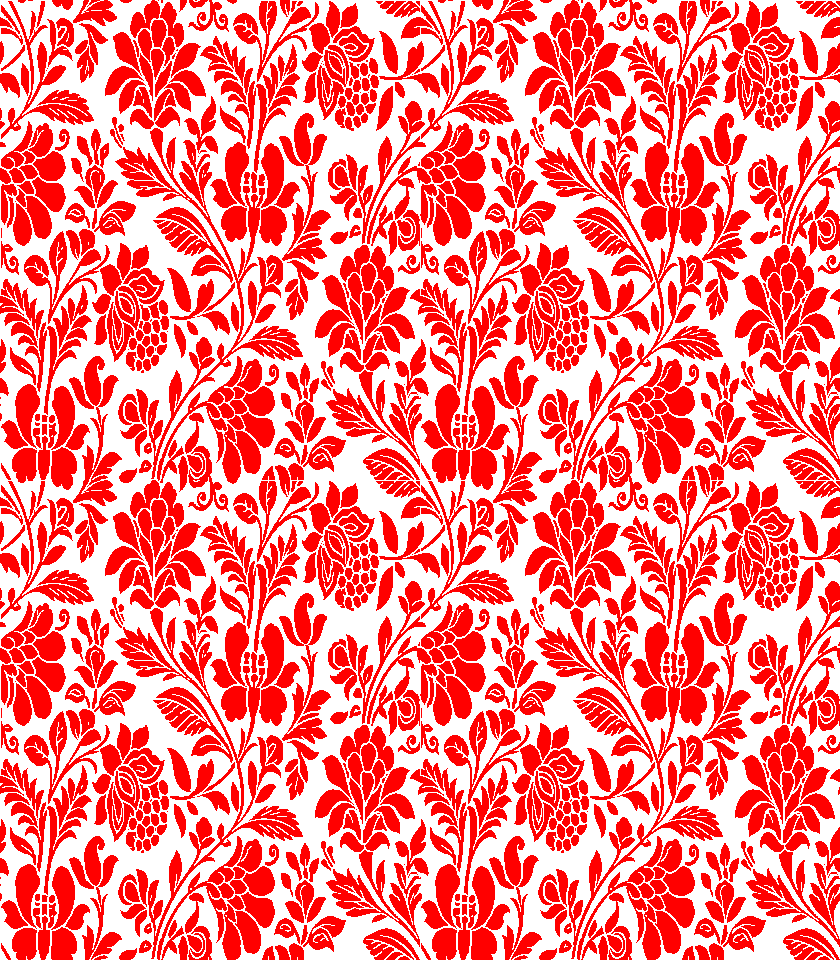
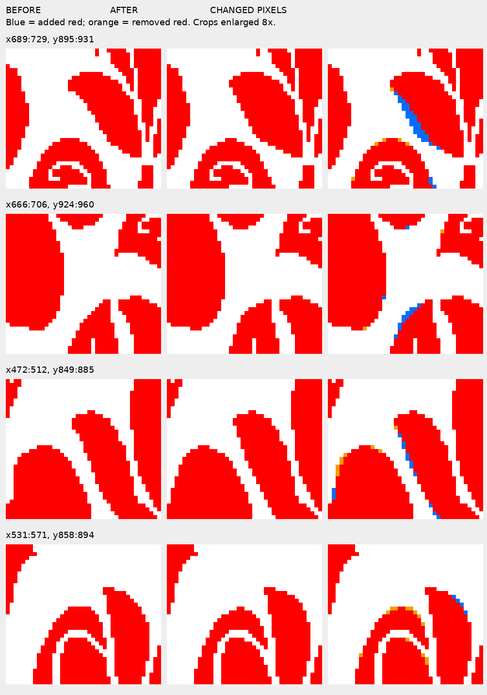

# GNR 107: full-image staircase trial

This is a new **partial alteration** of the uploaded GNR 107 BMP. The earlier three-image review pack contained diagnostics only. The original upload remains unchanged.

[View/download the complete altered PNG](GNR_107_staircase_trial.png) · [Download BMP](GNR_107_staircase_trial.bmp) · [Full before/after](GNR_107_full_before_after.png) · [Enlarged change crops](GNR_107_changed_crops.png) · [Download all trial files](GNR_107_staircase_trial.zip)

The complete output retains **840 × 960 pixels** and exactly pure red/white. The existing v5.1 constructor accepted **100 local A/M/B corner edits**, changing **433 pixels (0.0537% of the canvas)**: 238 red additions and 195 red removals. Full-image appearance therefore changes only subtly.

This is a conservative staircase demonstration, **not an image with all business rules completed**. Semantic two-pixel separation, paired inner/outer front/back relationships, unsupported contour shapes and motif interpretation remain unresolved. No model generation, resampling, whole-image filling or repeat copying was applied.

## Entire altered image

## Enlarged changes

The diagnostic column uses blue for added red pixels and orange for removed red pixels. Those colours do not appear in the PNG/BMP output. Crop enlargements use nearest-neighbour display only.

## What was checked

- Each accepted constructed arc was re-extracted from the actual raster and checked against the latest two-flat-anchor/shared-M staircase grammar. Both halves hold or decrease step lengths by one level toward the shared one-pixel transition.
- Edits remained within two native pixels of the original boundary and within a cumulative 1% canvas budget. Enclosed white holes and distant white were protected.
- The existing local neighbour-clearance and raster-connectivity guards were applied. These geometric checks do not identify semantic pieces or prove the entire design.
- Previously passing local corner checks were protected. Unsupported or infeasible corners were retained and remain in the audit.
- Native PNG/BMP pixels, file dimensions and source checksum were verified. There is no matching designer target here, so no designer accuracy or manual-effort percentage is claimed.

The raster gap screen reports 1267 narrow regions before and 1267 after. It cannot distinguish semantic pieces within a connected raster region and is not proof of full separation. Raw staircase pass/fail/unresolved counts likewise are not a production-quality percentage.

[Detailed edit records and unresolved audit](report.json).
