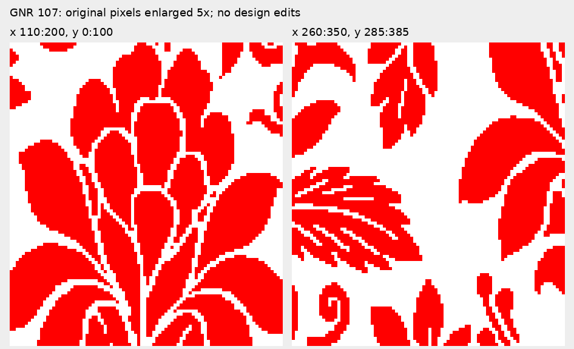
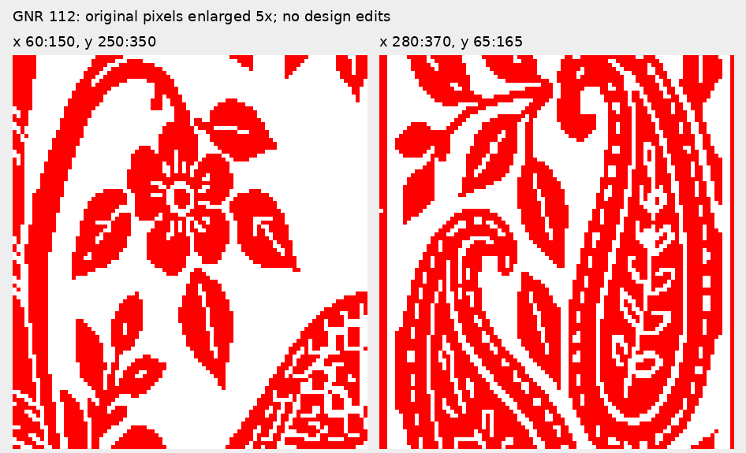
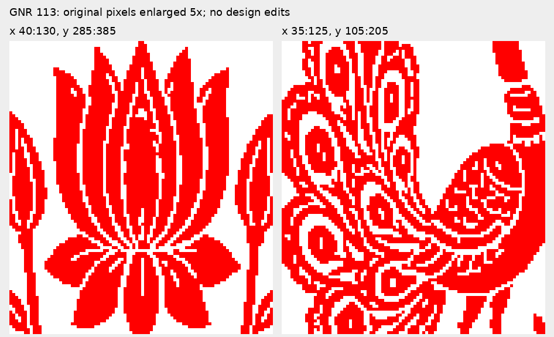

# Review of the three uploaded Sunburst BMPs

[Download review ZIP](https://github.com/MBG0903/GNR_Design_Project/raw/refs/heads/main/examples/sunburst_107_112_113_review/GNR_107_112_113_review.zip) · [Download standalone HTML report](https://github.com/MBG0903/GNR_Design_Project/raw/refs/heads/main/examples/sunburst_107_112_113_review/GNR_native_pixel_review.html)

The review and enlarged crops are also displayed directly below. Download the HTML file and open it in a browser to see the full compositions without extracting the ZIP.

The compositions are useful baselines. All three already contain only pure red and pure white. The next improvement is local boundary construction and semantic separation, while preserving existing ornament and white details.

No original image was edited. Native dimensions below refer to the supplied Step_3 files; matching Step_2 files are needed to verify the required source dimensions.

| File | Native pixels | Exact red/white | Red coverage (not accuracy) | One-white-pixel gap locations |
|---|---|---|---|---|
| GNR 107 | 840 × 960 | Yes | 50.65% | 2,824 |
| GNR 112 | 400 × 960 | Yes | 50.90% | 1,546 |
| GNR 113 | 400 × 960 | Yes | 41.61% | 413 |

Measurements use original BMP pixels. The one-pixel-gap count is the number of white pixel locations with red immediately on both horizontal sides or both vertical sides, where those red pixels belong to different 8-connected raster regions. Each location is counted once. This is a screening result, not a count of semantic pieces or a complete gap audit. It excludes many diagonal relationships and cannot identify semantic pieces that are already joined. Small regions may be intentional ornament, not noise. The automated A/M/B corner checker is too narrow to turn its raw counts into a whole-image quality percentage. No matching Step_2 or designer reference was supplied for these three files; neither sketch fidelity nor designer accuracy can be measured here.

## GNR 107: Floral petals and narrow leaf channels

Inspect x110:200, y0:100 for narrow petal separations; x260:350, y285:385 for leaf edges and internal channels. These are review windows, not rectangles to replace wholesale. The design has an almost exact 420 × 480 repeat. The horizontal shift differs at 48 of 403,200 pixels; the vertical shift differs at 36 of 403,200 pixels. Inspect these small differences before choosing an approved master.

## GNR 112: Fine flower and paisley details

Inspect x60:150, y250:350 around the flower, small leaves and the peacock edge. Inspect x280:370, y65:165 around the paisley. Several white details are only one pixel wide. A white channel is not automatically a defect: preserve intentional veins and ornament structure. Distinguishing those details from required gaps between separate pieces needs designer input.

## GNR 113: Lotus separations and peacock ornament

Inspect x40:130, y285:385 around the lotus: some petal separations and internal slits are very narrow. Inspect x35:125, y105:205 around the peacock feather detail. Protect feather eyes and channels while reviewing the outer contour. The lower red coverage reflects its panel composition; it is not evidence that the whole image needs denser filling.

## Recommended correction pilot

1. **Start with GNR 107.** Select one 420 × 480 repeat and correct complete motifs within it. Use wrapped context at the repeat edges so stems and leaves crossing those edges stay continuous. Do not regenerate independent rectangular tiles.

2. **Use the designer library at native size.** Retrieve complete matching leaves, petals and ornaments from approved assets. Replace a region only after semantic and native-width/height checks. Copy pixels without scaling, rotation interpolation or a later broad fill pass. A library source still needs approval; provenance alone does not prove every rule.

3. **Construct stairs on selected contour arcs.** Choose two boundary anchors and the shared boundary transition M. Treat long flats as free length; from either anchor toward M, step lengths hold or shrink one level toward the shared 1-pixel transition, using the designer-approved 4/3/2-to-1 grammar. Do not reinstate the earlier step-count-dominance interpretation. Unsupported shapes remain unresolved.

4. **Check spacing and white structure together.** Require two native white pixels at the nearest approach of separately identified semantic pieces. Preserve wider background spaces, continuous stems and deliberate internal white. Check spacing again after every stair edit. If the two requirements cannot fit the existing shape, request a local designer decision rather than automatically thinning or joining pieces.

5. **Approve once, reuse consistently.** Review native-pixel crops with the designer. Lock accepted red and white pixels, then propagate the approved repeat in GNR 107. Check opposite repeat edges and all placements after assembly. For GNR 112/113, approve detail families individually instead of flattening an entire panel.

6. **Measure improvement against the original baseline.** Keep the uploaded BMPs as baselines. Report added/removed pixels, unresolved motifs and actual designer correction time. These quantify change and effort; pixel-change percentage by itself does not establish accuracy or manual work remaining.

